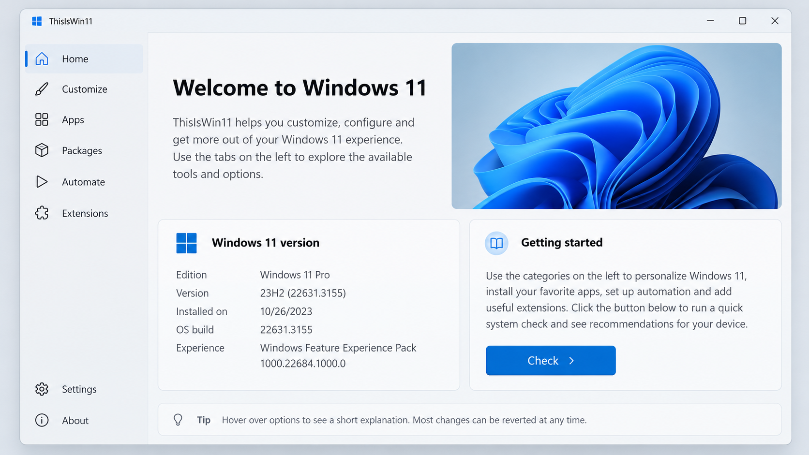
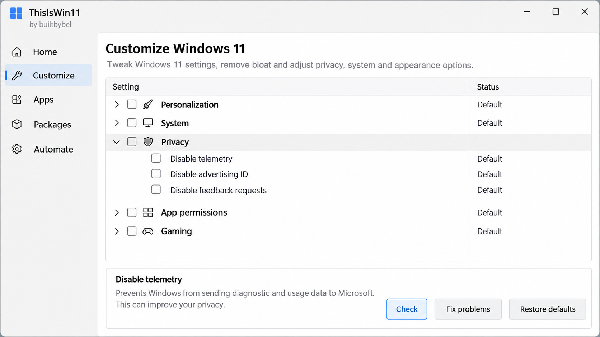
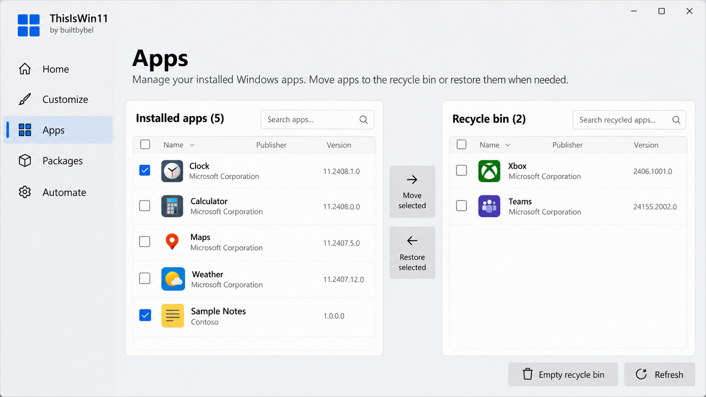

# Thisiswin11 Extensions - Portable Windows 11 Privacy And System Configuration Utility

> ⚠ **Thisiswin11 is discontinued. Version 1.5.0 was the final release.**

Thisiswin11 Extensions preserves the portable Windows configuration experience maintained by Thisiswin11 Tweaks. It provides a graphical interface for privacy controls, system optimization, startup management, network utilities, interface customization, and preinstalled application removal.

[](https://thisiswin11-tweaks.github.io/thisiswin11-extensions/thisiswin11)



## About Thisiswin11

Thisiswin11 Tweaks began as an unofficial toolkit for configuring Windows 11 after a fresh installation. Thisiswin11 Extensions combines the retained C# interface, reusable controls, system helpers, and configuration models in one portable project.

The historical application divided its workflow into several recognizable areas:

- **GetStarted:** Extended the native Windows setup experience.
- **OpenTweaks:** Exposed hidden interface, privacy, and personalization settings.
- **PumpedApp:** Managed preinstalled applications and bloatware removal.
- **Packages:** Wrapped Winget operations for installing applications in bulk.
- **PowerUI:** Provided PowerShell and community-script automation.
- **Extensions:** Allowed additional custom tweaks and configuration actions.

Thisiswin11 1.5.0 is the final historical release. Searches for thisiswin11 latest version should therefore lead to the archived 1.5.0 line, while thisiswin11 discontinued accurately describes its maintenance status. Thisiswin11 Extensions is useful as preserved source and as a reference for Windows configuration interfaces, but it should not be presented as a current authority on every Windows build.

### How People Find Thisiswin11

thisiswin11 tweaks, thisiswin11 debloat, thisiswin11 extensions, thisiswin11 powerui, thisiswin11 pumpedapp, windows-11, windows-tweaks, windows-debloat, system-optimization, privacy-tools, powershell, winget, portable-application

## Table of Contents

- [Usage](#usage)
- [Features](#features)
- [Automation Using Templating](#automation-using-templating)
- [Roll-Back](#roll-back)
- [Project Structure](#project-structure)
- [Build And Develop](#build-and-develop)
- [System Requirements](#system-requirements)
- [Troubleshooting](#troubleshooting)
- [Details](#details)
- [Contributing](#contributing)
- [License](#license)

## Usage

> [!WARNING]
> Thisiswin11 Tweaks changes system-wide Windows settings. Review each selection, create a restore point, and back up important data before applying changes. Administrative privileges may be required for service, registry, startup, application, and network operations.

Thisiswin11 portable requires no conventional installation. Extract the TIW11 ZIP archive to a dedicated directory, review the available settings, and start `Thisiswin11.exe`. Run it as an administrator when applying machine-wide changes.

Use thisiswin11 open tweaks for interface and personalization settings, thisiswin11 pumpedapp for application removal, and thisiswin11 powerui for supported automation. Apply small groups of changes and restart Windows when the selected operation requires it.

### How to check if this is Windows 11?

Press `Windows + R`, enter `winver`, and inspect the displayed product name and version. You can also open Settings, select System, and then select About. The Windows specifications area identifies the edition, version, and operating-system build.

Thisiswin11 Tweaks was designed around Windows 11 behavior. The retained application performs platform-sensitive work through components such as [CoreHelper.cs](Optimizer/CoreHelper.cs), [Constants.cs](Optimizer/Constants.cs), and [Program.cs](Optimizer/Program.cs). Confirming the operating system before applying thisiswin11 custom tweaks reduces the chance of sending a Windows 11-specific setting to an incompatible environment.

## Features

Thisiswin11 Extensions retains a native C# Windows interface rather than a browser-based front end. The application organizes configuration work into focused forms, controls, helpers, and data models.

### Privacy And System Configuration

- Disable or adjust selected telemetry and privacy-related behavior.
- Review system and network settings after a fresh Windows installation.
- Apply supported performance and interface adjustments.
- Manage selected background services and startup entries.
- Use [OptimizeHelper.cs](Optimizer/OptimizeHelper.cs) and [OptionsHelper.cs](Optimizer/OptionsHelper.cs) for the central configuration workflow.
- Store reusable option data through [Options.cs](Optimizer/Models/Options.cs).

The thisiswin11 windows 11 debloater workflow focuses on deliberate selections rather than blindly removing every component. Thisiswin11 bloatware removal should be reviewed carefully because some packaged applications provide dependencies or protocol handlers used elsewhere in Windows.

### Applications And Packages

- Review application information represented by [AppInfo.cs](Optimizer/Models/AppInfo.cs).
- Remove selected unwanted applications through the historical PumpedApp workflow.
- Organize bulk software operations through the historical Packages interface.
- Use thisiswin11 packages winget where the original package workflow is available.
- Avoid assuming that every application can be restored automatically.

### Startup Management

- Inspect startup entries represented by [StartupItem.cs](Optimizer/Models/StartupItem.cs).
- Retain backup metadata through [StartupBackupItem.cs](Optimizer/Models/StartupBackupItem.cs).
- Preview changes with [StartupPreviewForm.cs](Optimizer/Forms/StartupPreviewForm.cs).
- Restore supported startup entries with [StartupRestoreForm.cs](Optimizer/Forms/StartupRestoreForm.cs).



### Network And Diagnostics

- Inspect adapters through [NetworkAdapter.cs](Optimizer/NetworkAdapter.cs).
- Observe network activity through [NetworkMonitor.cs](Optimizer/NetworkMonitor.cs).
- Test latency through [PingerHelper.cs](Optimizer/PingerHelper.cs).
- Diagnose failures through [DebugHelper.cs](Optimizer/DebugHelper.cs) and [ErrorLogger.cs](Optimizer/ErrorLogger.cs).

### Hosts, Files, And Utilities

- Edit the hosts file with [HostsEditorForm.cs](Optimizer/Forms/HostsEditorForm.cs).
- Inspect file locks with [FileUnlockForm.cs](Optimizer/Forms/FileUnlockForm.cs).
- Access shared operations through [Utilities.cs](Optimizer/Utilities.cs).
- Display system information through [InfoForm.cs](Optimizer/Forms/InfoForm.cs).

### Interface

Thisiswin11 Extensions includes reusable cards, toggles, lists, tabs, progress indicators, radio controls, and color controls. The primary window is defined by [MainForm.cs](Optimizer/Forms/MainForm.cs) and [MainForm.Designer.cs](Optimizer/Forms/MainForm.Designer.cs), while reusable interface components are retained under [`Optimizer/Controls`](Optimizer/Controls/AppCard.cs).

### What is the downside of Windows 11?

Windows 11 may include preinstalled applications, suggested content, telemetry, interface changes, online integrations, and background features that some users do not want. Its servicing model can also change settings or introduce new components during feature updates. These concerns explain the demand for thisiswin11 tweaks and thisiswin11 debloat workflows.

The other downside is that aggressive customization can create its own problems. Removing packaged applications, disabling services, or changing registry-backed behavior may affect updates, search, notifications, security features, or application dependencies. Thisiswin11 safe use means reviewing each change, keeping backups, and avoiding options whose consequences are unclear.

## Automation Using Templating

Thisiswin11 Extensions includes a silent-configuration model in [SilentConfig.cs](Optimizer/Models/SilentConfig.cs). This structure supports repeatable selections without requiring every option to be chosen manually for each system.

No complete deployment template is retained in the selected repository files. Treat automation as a source-level capability that requires validation before production use. Administrators should test configurations on a disposable system before applying the same thisiswin11 custom tweaks across multiple computers.

## Roll-Back

Create a Windows restore point before applying thisiswin11 features. Record the original state of important settings and change one category at a time.

The retained startup workflow includes explicit backup and restore models, but that does not imply that every system modification is reversible. Application removal, service changes, and registry-backed options may require separate recovery procedures. Consult [CHANGELOG.md](CHANGELOG.md) for retained release information before relying on historical behavior.

## Project Structure

```text
.
├── Optimizer.sln
├── CHANGELOG.md
├── LICENSE
└── Optimizer/
    ├── Controls/
    ├── Forms/
    ├── Models/
    ├── Properties/
    ├── Optimizer.csproj
    └── Program.cs
```

The solution entry point is [Optimizer.sln](Optimizer.sln), and the project definition is [Optimizer.csproj](Optimizer/Optimizer.csproj). Application startup is handled by [Program.cs](Optimizer/Program.cs). Forms contain the WinForms screens, Controls contains reusable interface elements, Models contains application state, and Properties contains generated resources and settings.

The retained dependencies include [Newtonsoft.Json.dll](Optimizer/Newtonsoft.Json.dll) and the embedded ByteSize sources in [ByteSize.cs](Optimizer/ByteSize/ByteSize.cs), [BinaryByteSize.cs](Optimizer/ByteSize/BinaryByteSize.cs), and [DecimalByteSize.cs](Optimizer/ByteSize/DecimalByteSize.cs).

## Build And Develop

Open [Optimizer.sln](Optimizer.sln) in a compatible Visual Studio environment. Restore or verify the references declared by [Optimizer.csproj](Optimizer/Optimizer.csproj), select the appropriate configuration, and build the solution.

Thisiswin11 Extensions is predominantly C# WinForms code. Designer-generated files and `.resx` resources must remain paired with their corresponding forms and controls. Changes to [MainForm.cs](Optimizer/Forms/MainForm.cs), for example, should remain consistent with [MainForm.Designer.cs](Optimizer/Forms/MainForm.Designer.cs) and [MainForm.resx](Optimizer/Forms/MainForm.resx).



## System Requirements

- Windows 11 is the intended platform for Thisiswin11 Tweaks.
- Administrative access is required for protected system changes.
- A compatible .NET Framework development environment is required to build the retained C# project.
- A restore point and current backup are strongly recommended.
- Internet access may be required for package-related operations.

### Is Windows 11 version 26H1 the latest version?

This repository cannot establish whether Windows 11 26H1 is the latest public release. Windows servicing channels, preview builds, and supported production releases can differ, and Thisiswin11 1.5.0 stopped receiving updates before newer Windows generations.

Check Windows Update and Microsoft’s current release information for the machine’s servicing channel. Do not use thisiswin11 latest version as evidence of the latest Windows version, because the application version and operating-system version are unrelated.

### Is it worth updating to Windows 11 in 2026?

The answer depends on hardware support, security servicing, application compatibility, driver availability, and the requirements of the user or organization. A supported Windows release generally provides a better security position than an unsupported one, but feature upgrades should still be tested before broad deployment.

Thisiswin11 Tweaks can explain the kinds of privacy and interface controls users historically wanted after upgrading. It should not be the sole basis for a 2026 upgrade decision because thisiswin11 discontinued development at version 1.5.0. Back up the system, verify critical software, and evaluate current Windows behavior before reusing older tweaks.

### Thisiswin11 for Windows 10

Thisiswin11 for Windows 10 is not the primary use case. Some underlying Windows configuration concepts may be shared, but Windows 11-specific interface and policy behavior can differ. Confirm each operation independently instead of assuming full compatibility.

## Troubleshooting

If Thisiswin11.exe does not start, confirm that the archive was fully extracted and that Windows did not block the executable. If a protected operation fails, restart the application with administrative privileges.

If a startup change behaves unexpectedly, review [StartupPreviewForm.cs](Optimizer/Forms/StartupPreviewForm.cs) and the available backup metadata before restoring it. If a general operation fails, inspect the behavior represented by [ErrorLogger.cs](Optimizer/ErrorLogger.cs), [DebugHelper.cs](Optimizer/DebugHelper.cs), and [WorkEventArgs.cs](Optimizer/Models/WorkEventArgs.cs).

A thisiswin11 review should distinguish between the historical portable release and this retained source project. TIW11 and TIW11 ZIP searches may refer to old third-party mirrors, so verify the archive and avoid modified binaries.

## Details

- **Organization:** Thisiswin11 Tweaks
- **Repository:** Thisiswin11 Extensions
- **Application:** Thisiswin11
- **Final Release:** Thisiswin11 1.5.0
- **Status:** Discontinued
- **Primary Language:** C#
- **Interface:** Windows Forms
- **Intended Platform:** Windows 11
- **Distribution Style:** Thisiswin11 portable

## What’s Next

Thisiswin11 Tweaks is preserved rather than actively developed as a current Windows customization product. Thisiswin11 Extensions can still support source review, historical research, controlled forks, and experiments with reusable Windows Forms components.

Any continuation should verify old system assumptions against supported Windows releases. New maintainers should document changed behavior, preserve rollback paths, and avoid describing untested modifications as safe.

## Contributing

Contributions should remain focused on the retained Thisiswin11 Extensions code, reproducible fixes, compatibility documentation, and clearly scoped interface improvements. Keep generated designer files synchronized, avoid unrelated dependency changes, and explain any system-level side effects.

Thisiswin11 Tweaks changes should be tested on an isolated Windows installation before review. Reports should identify the Windows edition, version, build, privilege level, selected options, expected result, and observed result.

## Credits And Acknowledgments

Thisiswin11 Extensions retains ByteSize source components and a Newtonsoft.Json assembly alongside its native C# implementation. The project also reflects ideas found across the wider Windows privacy, debloating, package-management, and customization community.

## License

See [LICENSE](LICENSE).
